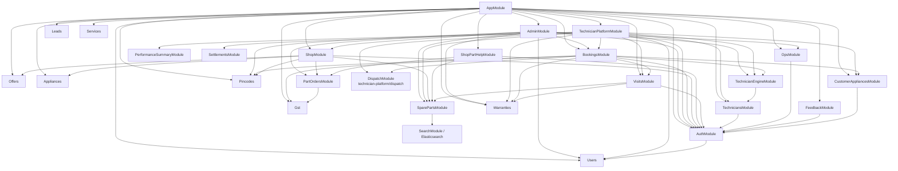

# fixer-backend — Codebase Map

Feature → files → dependencies for the NestJS API. Generated from source on 2026-11-26 (commit `8b0a9e94`).
**Keep it current:** when you add or move a module, controller, schema or cron, update the matching row here.

- All paths are relative to `src/`.
- Web consumer = the page in `fixer-frontend` that calls the route. "—" = no web caller (mobile app, scripts, or unused).
- Two route prefixes exist: **`/api/v1/*`** (customer web + admin) and **`/v1/*`** (technician mobile app + settlements/tech-platform admin).
- Server port: `process.env.PORT || 8081` (`main.ts`). Frontend default `API_URL` is `http://127.0.0.1:8081/api/v1` (`app/config.ts`).

---

## 1. Module dependency graph

Arrows read "imports / depends on". Engine and leaf modules sit at the bottom; nothing below may import upward.



Leaf modules (no feature imports): `Users`, `Gst`, `Leads`, `Offers`, `Services`, `Appliances`, `ServiceablePincodes`, `Warranties`, `Dispatch`, `Settlements`, `PerformanceSummary`.

**Hard rule:** Bookings → Engine only. `TechnicianScheduleService` reads Booking/Technician models directly and never injects `BookingsService`. Controllers import pure engine files (`technician-engine/technician-schedule.ts`, `technician-engine.ts`), not `technician-engine/index.ts`. The index re-exports the Nest module and drags in AuthModule.

---

## 2. Feature → files

### 2.1 Customer auth
| | |
|---|---|
| Routes | `POST /api/v1/auth/{register,login,quick-login,google,send-email-otp,verify-email-otp}`, `GET /api/v1/auth/me` |
| Controller | `auth/auth.controller.ts` |
| Services | `auth/auth.service.ts` (JWT issue, phone normalize), `auth/email-otp.service.ts`, `auth/email.service.ts` → `auth/azure-email.service.ts` |
| Guards / strategies | `auth/guards/roles.guard.ts` + `auth/decorators/roles.decorator.ts`, `auth/guards/quick-login-rate-limit.guard.ts`, `auth/strategies/{jwt,local}.strategy.ts` |
| Schemas | `auth/schemas/email-otp-session.schema.ts`, `users/schemas/user.schema.ts` |
| Shared | `common/jwt-secret.ts`, `auth/templates/otp-email.template.ts`, `mail/email-layout.ts` |
| Tests | `auth/auth.service.spec.ts`, `auth/auth.controller.spec.ts`, `users/users.service.spec.ts` |
| Web consumer | `app/context/AuthContext.tsx`, `app/login/*`, `app/register/*`, `app/admin/login/page.tsx` |
| Docs | `docs/google-signin.md`, `docs/azure-email-otp.md`, `docs/aws-ses-email.md` |

### 2.2 Service catalogue
| | |
|---|---|
| Routes | `GET /api/v1/services`, `GET /api/v1/services/:slug`; admin `POST/PUT/DELETE /api/v1/services[/:id]` |
| Files | `services/services.controller.ts`, `services/services.service.ts`, `services/schemas/service.schema.ts` (Service + SubCategory), `services/dtos/service.dto.ts` |
| Web consumer | `app/lib/services-api.ts` → `ServicePickerSection`, `BookingForm`. Admin CRUD has no web page. |

### 2.3 Booking (create / list / cancel / warranty claim) — customer side
| | |
|---|---|
| Routes | `POST /api/v1/bookings`, `GET /api/v1/user/bookings`, `POST /api/v1/user/bookings/:id/cancel`, `POST /api/v1/user/bookings/:id/claim-warranty` |
| Controller | `bookings/bookings.controller.ts` |
| Service | `bookings/bookings.service.ts`: `create` L809, `findAllByUser` L510, `cancelBooking` L935, `claimWarranty` L2792 |
| Helpers | `bookings/customer-booking.helpers.ts` (customer-safe projection / pricing view), `bookings/fixxer-code.ts` (completion code) |
| Schema | `bookings/schemas/booking.schema.ts`: Booking + ProductDetails, JobDetails, AdditionalCharge, InvoiceData, JobCompletionData, AddressData, BookingChangeHistoryEntry, QualityReviewHistoryEntry |
| Depends on | ServiceablePincodes (area check), CustomerAppliances (serial ↔ phone), Dispatch (marketplace broadcast), Warranties |
| Tests | `bookings/customer-booking.helpers.spec.ts`, `bookings/bookings.pricing.spec.ts`, `bookings/fixxer-code.spec.ts` |
| Web consumer | `app/components/BookingForm.tsx`, `app/components/PendingBookingConfirmDialog.tsx`, `app/my-bookings/page.tsx` |

### 2.4 Admin booking management (status, assign, job/product details, invoice)
| | |
|---|---|
| Routes | `/api/v1/admin/bookings` (list, `:id`, `export`, `needs-assignment`, `awaiting-review`), `PUT :id/{status,assign,unassign,job-details,product-details,service-properties,invoice-manual,finalize-invoice}`, `POST :id/notes` |
| Controller | `admin/admin.controller.ts` (thin; delegates to BookingsService) |
| Service methods | `findAllForAdmin` L644, `findOne` L784, `populateBookingDetail` L426, `updateStatus` L1200 (state machine), `assignTechnician` L1446, `unassignTechnician` L388, `updateJobDetails` L1960, `updateProductDetails` L2025, `updateServiceProperties` L2114, `updateInvoiceManual` L2196, `finalizeInvoice` L2265, `generateInvoiceData` L2396, `addAdminNote` L2374, `unlockSheet` L2348 |
| Invoice / bill | `bookings/invoice-pdf.ts`, `bookings/bill-email.service.ts`, `bookings/templates/bill-email.template.ts`, `bookings/job-sheet-defaults.ts`, GstModule |
| Email preview | `bookings/email-preview.controller.ts` → `GET /api/v1/email-preview[/bill]` (web: `app/email-preview/page.tsx`) |
| Tests | `bookings/bookings.state-machine.spec.ts`, `bookings/bookings.invoice-gen.spec.ts`, `bookings/bookings.job-sheet-sync.spec.ts`, `bookings/job-sheet-defaults.spec.ts` |
| Web consumer | `app/admin/bookings/page.tsx`, `app/admin/bookings/[id]/page.tsx`, `app/admin/page.tsx` (dashboard list) |

### 2.5 Staff slot scheduling (admin as technician-app substitute)
| | |
|---|---|
| Routes | `GET /api/v1/admin/schedule?date=`, `GET schedule/free-technicians`, `GET schedule/check`, `GET schedule/technicians/:id/free-slots`, `PUT bookings/:id/slot` (also `assign` with slot) |
| Pure rules | `technician-engine/technician-schedule.ts` (IST day, 8–21 soft window, clash detection, overrun cascade) |
| Reads + slot lock | `technician-engine/technician-schedule.service.ts` (Mongo transaction, needs a replica set) |
| Writes | `bookings/bookings.service.ts`: `assignTechnician` L1446, `rescheduleSlot` L1621, `applyOverrunShift` L1729, `applyShifts` L1762, `slotConflict` L1864, `assertStaffSlotStillFree` L1904, `requireStaffSlot` L1838 |
| Cron | `bookings/booking-slot-shift.scheduler.ts` (every 5 min → overrun +1h shift) |
| Tests | `technician-engine/technician-schedule.spec.ts` |
| Web consumer | `app/admin/schedule/page.tsx`, `app/admin/components/StaffSlotModal.tsx`, `app/lib/admin-schedule.ts` |
| Docs | `docs/mongodb-replica-set.md` |

### 2.6 Technician assignment engine & dispatch
| | |
|---|---|
| Engine | `technician-engine/technician-engine.ts` (pure eligibility/ON_JOB rules), `technician-engine/technician-engine.service.ts`, `technician-engine/technician-engine.types.ts` |
| Marketplace dispatch | `technician-platform/dispatch/job-dispatch.service.ts`, `dispatch/service-category.util.ts`, `common/notification-dispatch.service.ts` |
| Cron | `technician-platform/dispatch/dispatch-escalation.scheduler.ts` (every minute; ~10 min unclaimed TTL escalation) |
| Booking side | `resolveTechnicianForCustomer` L186, `assertTechnicianFreeFor` L280, `releaseTechnicianIfIdle` L259, `reconcileAssignmentInvariant` L414 |
| Tests | `technician-engine/technician-engine.spec.ts`, `technician-platform/dispatch/*.spec.ts` |
| Note | PARTNER techs only. FIXXER_STAFF are never broadcast. |

### 2.7 Visits & spare-part usage (job sheet parts)
| | |
|---|---|
| Admin routes | `POST /api/v1/admin/visits`, `GET visits/booking/:bookingId`, `PUT visits/:id/status`, `POST visits/:id/parts` |
| Files | `visits/visits.controller.ts`, `visits/visits.service.ts`, `visits/schemas/{visit,spare-part-usage,part-inventory-transaction}.schema.ts` |
| Depends on | SpareParts (stock), Warranties (part warranty) |
| Tests | `visits/visits.service.spec.ts` |
| Web consumer | `app/admin/bookings/ManageVisitsModal.tsx`, `app/admin/bookings/AddPartModal.tsx`, `app/lib/admin-manage-visits.ts` |

### 2.8 Warranties
| | |
|---|---|
| Admin routes | `GET /api/v1/admin/bookings/:id/warranties`, `GET admin/warranties/by-serial/:serial`, `GET admin/warranties` |
| Files | `warranties/warranties.service.ts`, `warranties/schemas/warranty.schema.ts` (no own controller; exposed via admin + bookings) |
| Booking side | `lockServiceWarranty` L1021, `registerWarrantiesOnComplete` L1103, `claimWarranty` L2792 |
| Tests | `warranties/warranties.service.spec.ts` |
| Web consumer | `app/admin/bookings/[id]/page.tsx`, `app/my-bookings/page.tsx`, `app/warranty/page.tsx` (static) |

### 2.9 Quality review & corrective bookings
| | |
|---|---|
| Routes | `PUT /api/v1/admin/bookings/:id/quality-review`, `POST admin/bookings/:id/corrective`, `GET admin/bookings/awaiting-review` |
| Service | `markAwaitingQualityReview` L2670, `submitQualityReview` L2685, `createCorrectiveBooking` L2752 (child booking via `parentId`), `isJobFinished` L2652 |
| Schema | `QualityReviewHistoryEntry` in `bookings/schemas/booking.schema.ts` |
| Tests | `bookings/quality-review.spec.ts` |
| Web consumer | `app/admin/bookings/[id]/page.tsx` |

### 2.10 Change history (append-only audit)
| | |
|---|---|
| Route | `GET /api/v1/admin/bookings/:id/change-history` (no web caller found; history is read from booking detail) |
| Files | `bookings/booking-change-history.ts` (diff/entry builders), `appendChangeHistory` L1171, `getChangeHistory` L1184, `scheduleEvent` L1877 |
| Schema | `BookingChangeHistoryEntry` in `booking.schema.ts` |
| Tests | `bookings/booking-change-history.spec.ts`, `bookings/change-history.service.spec.ts` |
| Rule | Admin-only. Technician payloads strip it. Never overwrite entries. |

### 2.11 Feedback & recovery queue
| | |
|---|---|
| Routes | customer `POST/GET /api/v1/user/bookings/:id/feedback`; admin `GET /api/v1/admin/feedback`, `GET admin/feedback-follow-ups`, `PATCH admin/feedback-follow-ups/:id` |
| Files | `feedback/feedback.controller.ts`, `feedback/feedback.service.ts`, `feedback/schemas/{feedback,feedback-follow-up}.schema.ts`, `feedback/dtos/*` |
| Rule | rating ≤2 or unresolved → FeedbackFollowUp (owner, due, resolution) |
| Tests | `feedback/feedback.service.spec.ts` |
| Web consumer | `app/my-bookings/page.tsx` (submit), `app/admin/feedback/page.tsx` |

### 2.12 Ops pending / overdue queue
| | |
|---|---|
| Routes | `GET /api/v1/admin/ops/overdue`, `GET/PUT admin/ops/settings`, `PUT admin/ops/bookings/:id/pending-work` (parts wait = `opsPartsWait`) |
| Files | `ops/ops.controller.ts`, `ops/ops-queue.service.ts`, `ops/ops-settings.service.ts`, `ops/schemas/ops-settings.schema.ts`, `ops/dtos/*` |
| Cron | `ops/ops-queue.scheduler.ts` (every 5 min) |
| Used by | `admin/admin.service.ts` (dashboard counts) |
| Tests | `ops/ops-queue.service.spec.ts` |
| Web consumer | `app/admin/ops/page.tsx`, `app/admin/schedule/page.tsx` (parts-wait flag) |

### 2.13 Admin dashboard, users, revenue, customer history
| | |
|---|---|
| Routes | `GET /api/v1/admin/{dashboard,revenue,users}`, `PUT admin/users/:id/role`, `GET admin/customers/:customerId/service-history` |
| Files | `admin/admin.service.ts`, `admin/customer-service-history.service.ts`, `bookings.service.ts` `getFixxerRevenueStats` L2891, `countByStatus` L3168 |
| Tests | `admin/customer-service-history.service.spec.ts`, `admin/admin-customer-history-authorization.spec.ts` |
| Web consumer | `app/admin/page.tsx` (dashboard), `app/admin/users/page.tsx`. Revenue and service-history have no web caller yet. |

### 2.14 Technicians (admin CRUD, applications, verification)
| | |
|---|---|
| Routes | `/api/v1/admin/technicians`: create, list, `available`, `applications`, `verifications[/:documentId/approve\|reject]`, `:id[/details\|/verification\|/verification/request\|/activate\|/deactivate\|/approve\|/reject]`, PUT, DELETE |
| Files | `technicians/technicians.controller.ts`, `technicians/technicians.service.ts`, `technicians/schemas/technician.schema.ts` (`employmentType` PARTNER \| FIXXER_STAFF, BankDetails) |
| Backfill script | `scripts/backfill-employment-type.ts` |
| Tests | `technicians/technicians.service.spec.ts` |
| Web consumer | `app/admin/technicians/page.tsx`, `app/admin/technicians/[id]/page.tsx` |

### 2.15 Technician platform (mobile app, `/v1/*`) — not launched
| Feature | Routes | Files |
|---|---|---|
| OTP auth / tokens | `POST /v1/auth/{send-otp,verify-otp,refresh,logout}` | `technician-platform/auth/*`, `common/{otp,token}.service.ts`, `common/technician.guard.ts` (refuses FIXXER_STAFF) |
| Onboarding | `/v1/onboarding/*` (status, progress, check-pincode, profile, service-categories, pay-joining-fee, payment/webhook, events) | `onboarding/*`, `common/onboarding-progress.helper.ts`, `schemas/{allowed-pincode,payment-order,onboarding-event}.schema.ts`, `common/webhook-secret.ts` |
| Verification | `/v1/verification/{upload-document,status}` | `verification/*`, `schemas/verification-document.schema.ts` |
| Dashboard | `GET /v1/dashboard[/stats]` | `dashboard/*` |
| Jobs | `/v1/jobs` list/available/:jobId, claim, accept, reject, status, arrival | `jobs/technician-jobs.controller.ts`, `jobs/technician-jobs.service.ts` |
| Job sheet & parts | `/v1/jobs/:jobId/job-sheet`, `/visits`, `/visits/:visitId/parts[...]`, `/v1/jobs/part-transactions`, `GET /v1/spare-parts` | `job-sheet/job-sheet.service.ts`, `job-sheet/technician-spare-parts.controller.ts` |
| Completion | `/v1/jobs/:jobId/{generate-otp,verify-otp,customer-signature,completion,payment,close}` | served by `jobs/technician-jobs.controller.ts` → `job-completion/job-completion.service.ts` |
| Earnings | `GET /v1/earnings[/history\|/:id]` | `earnings/*`, `schemas/earning.schema.ts`, `technician-platform/settlement.ts` (share math) |
| Notifications | `/v1/notifications[/read\|/register-token]` | `notifications/*`, `schemas/notification.schema.ts` |
| Profile | `/v1/profile[/profile-picture\|/availability]` | `profile/*` |
| Tech-platform admin | `/v1/admin/technicians...`, `/v1/admin/verification...`, `/v1/admin/onboarding-call`, `/v1/admin/onboarding-analytics` | `admin/*`, `analytics/onboarding-analytics.service.ts` |
| Module | | `technician-platform/technician-platform.module.ts`, `constants.ts`, `dtos/*` |
| Tests | | `jobs/*.spec.ts`, `job-completion/job-completion.spec.ts`, `job-sheet/job-sheet.service.spec.ts`, `settlement.spec.ts` |

### 2.16 Settlements & performance summaries
| | |
|---|---|
| Settlements routes | `/v1/admin/settlements`: prepare, list, `:id`, approve, reject, payment, reconcile, cancel |
| Settlements files | `technician-platform/settlements/{settlements.controller,settlements.service,settlements.module,settlements.dto}.ts`, `schemas/{settlement,settlement-item}.schema.ts`, `technician-platform/settlement.ts` |
| Settlements cron | `settlements/settlement.scheduler.ts` (21:00 IST daily) |
| Performance routes | `GET /api/v1/admin/performance-summaries[/:date]` |
| Performance files | `technician-platform/performance/*`, `schemas/service-performance-summary.schema.ts` |
| Performance cron | `performance/performance-summary.scheduler.ts` (22:00 IST daily) |
| Script | `scripts/recalc-technician-earnings.ts` |
| Docs | `docs/technician-settlement-reconciliation-LLD.md` |
| Web consumer | — (no admin pages yet) |

### 2.17 Spare parts catalogue & search
| | |
|---|---|
| Routes | `/api/v1/spare-parts`: list, `:sku`, `suggestions`, `categories[/:type[/brands[/:brand/models]\|/:partCategory]]`, `meta/categories`; admin POST/PUT/DELETE, `refresh-tree`, `sync-search`. Admin `POST /api/v1/admin/spare-parts/bulk-upload`, `GET admin/spare-parts/{export,template}` |
| Files | `spare-parts/spare-parts.controller.ts`, `spare-parts/spare-parts.service.ts`, `spare-parts/schemas/{spare-part,appliance-type,brand,model,part-category,category-tree}.schema.ts`, `spare-parts/dtos/spare-parts.dto.ts` |
| Search | `search/search.service.ts` + `search/search.module.ts` (Elasticsearch) |
| Seeds / scripts | root `seed-spare-parts*.js`, `seed-5000-parts.js`, `sample-spare-parts.csv`, `MARUTI_SPARE_2025.xlsx`, `scripts/fix-spare-part-unit-prices.js` |
| Web consumer | `app/lib/spareParts.ts`, `app/lib/catalog-api.ts`, `app/components/shop/spare-parts/SparePartsPage.tsx`, `app/components/shop/detail/SparePartDetail.tsx`, `app/admin/spare-parts/*` |

### 2.18 Appliances (AC catalogue)
| | |
|---|---|
| Routes | `GET /api/v1/appliances`, `GET appliances/ac`, `GET appliances/ac/:slug`, `GET appliances/:slug`; admin `POST appliances/ac`, `PUT appliances/ac/:slug` |
| Files | `appliances/appliances.controller.ts`, `appliances/appliances.service.ts`, `appliances/schemas/appliance.schema.ts`, `appliances/appliance-types.ts`, `appliances/dtos/appliance.dto.ts` |
| Data pipeline | `scripts/ac-pipeline/*` (scrape → verify images → Cloudinary → merge & seed), `scripts/seed-appliances.ts`, `scripts/seed-shop-appliances.ts` |
| Web consumer | `app/lib/catalog-api.ts`, `app/components/shop/ApplianceShopPage.tsx`, `app/components/shop/appliances/detail/ApplianceDetail.tsx`, `app/orders/page.tsx` |

### 2.19 Shop: home, cart, checkout, installation, wishlist, maintenance
| Feature | Routes | Files |
|---|---|---|
| Home / status | `GET /api/v1/shop/{home,status}` | `shop/shop.controller.ts`, `shop/shop.service.ts`, `shop/shop-settings.service.ts` |
| Maintenance switch | admin `GET/PUT /api/v1/admin/shop-settings` | `shop/shop-maintenance.guard.ts`, `shop/schemas/shop-settings.schema.ts` |
| Cart & coupons | `/api/v1/cart`, `cart/items[/:itemId]`, `cart/coupons[/:code]` | `shop/cart.controller.ts`, `shop/cart.service.ts` (uses Offers), `shop/schemas/cart.schema.ts`, `shop/dtos/cart.dto.ts` |
| Pricing | — | `shop/shop-pricing.ts` |
| Checkout | `POST /api/v1/checkout[/quote]` | `shop/checkout.controller.ts`, `shop/checkout.service.ts` → creates PartOrder |
| Installation | `GET /api/v1/installation/options` | `shop/installation.controller.ts`, `shop/installation.service.ts` (pincode-aware) |
| Wishlist (server) | `/api/v1/wishlist[/items\|/sync]` | `shop/wishlist.*`, `shop/schemas/wishlist.schema.ts`. **Not used by web**: the web wishlist is localStorage (`app/lib/shop-wishlist.ts`). |
| Seeds | | `scripts/seed-shop-catalog.ts` |
| Tests | | `shop/shop.spec.ts`, `home-data.integration.spec.ts` |
| Docs | | `docs/fixxer-shop-api.html`, `docs/Fixxer-Shop-API.docx`, `docs/p2-08-low-level-design.md` |

### 2.20 Part orders (spare-part + appliance orders)
| | |
|---|---|
| Customer routes | `POST /api/v1/part-orders`, `GET /api/v1/user/part-orders[/:id\|/:id/tracking]`, `POST user/part-orders/:id/cancel` |
| Admin routes | `GET /api/v1/admin/part-orders[/:id]`, `PUT :id/{bill,mark-paid,status,tracking}` |
| Files | `part-orders/part-orders.controller.ts`, `part-orders/part-orders.service.ts`, `part-orders/schemas/part-order.schema.ts` (OrderItem, ApplianceOrderItem, BillLineItem, OrderInvoiceData), `part-orders/dtos/*` |
| Tests | `part-orders/part-orders.service.spec.ts` |
| Web consumer | `app/components/SparePartsEnquiryForm.tsx`, `app/orders/*`, `app/components/shop/orders/OrderDetailsClient.tsx`, `app/admin/components/{AdminOrdersList,AdminOrderDetail}.tsx` |

### 2.21 Shop part help ("identify a part")
| | |
|---|---|
| Routes | `POST /api/v1/shop/part-help`; customer `GET /api/v1/user/part-help[/:id]`, `POST :id/{accept,decline,cancel}`; admin `GET /api/v1/admin/shop-part-help[/:id]`, `PUT :id/quote` |
| Files | `shop-part-help/shop-part-help.controller.ts`, `shop-part-help/shop-part-help.service.ts` (quote → PartOrder), `shop-part-help/schemas/shop-part-help.schema.ts`, `shop-part-help/dtos/*` |
| Tests | `shop-part-help/shop-part-help.service.spec.ts` |
| Web consumer | `app/components/ShopPartHelpForm.tsx`, `app/shop/requests/page.tsx` (list only; accept/decline not wired in web), `app/admin/part-help/page.tsx` |

### 2.22 GST
| | |
|---|---|
| Routes | `GET /api/v1/gst/rates`, `POST gst/extract`, `POST gst/breakdown` |
| Files | `gst/gst.engine.ts` (pure), `gst/gst.service.ts`, `gst/gst.types.ts`, `gst/gst.dto.ts`, `gst/gst.controller.ts` |
| Used by | Bookings (invoice), PartOrders (bills) |
| Tests | `gst/gst.engine.spec.ts` |
| Web mirror | `app/lib/gst.ts` re-implements the math client-side (keep the two in sync) |

### 2.23 Smaller features
| Feature | Routes | Files | Web consumer |
|---|---|---|---|
| Leads | `POST/GET /api/v1/leads` | `leads/*` | `app/components/LeadForm.tsx`, `app/admin/leads/page.tsx` |
| Offers | public `GET /api/v1/offers`; admin `/api/v1/admin/offers[/:id\|/:id/active]` | `offers/*`, `scripts/seed-demo-offers.ts` | `app/lib/offers-api.ts` → `HeroOffersCarousel`, `app/admin/offers/page.tsx`; coupons via Cart |
| Serviceable pincodes | admin `/api/v1/admin/serviceable-pincodes[/:id\|/:id/deactivate]` | `serviceable-pincodes/*`, root `pincode.seed.js`, `scripts/seed-allowed-pincodes.ts` | `app/admin/serviceable-pincodes/page.tsx` |
| Customer appliances (serial ↔ phone) | `GET /api/v1/user/appliances`; admin `/api/v1/admin/appliance-mappings[/search\|/by-serial/:serial\|/map\|/:serial/phones]` | `customer-appliances/*` | `app/admin/appliance-mappings/page.tsx` |

---

## 3. Booking lifecycle (call path)

```
Customer web BookingForm ──POST /bookings──► BookingsController.createBooking
   └─ BookingsService.create (L809)
        ├─ ServiceablePincodesService (area check)
        ├─ CustomerAppliancesService (serial/phone link)
        └─ JobDispatchService (PARTNER broadcast) ──cron──► DispatchEscalationScheduler (1 min)

Admin assign ──PUT admin/bookings/:id/assign──► BookingsService.assignTechnician (L1446)
   ├─ PARTNER: TechnicianEngineService eligibility
   └─ FIXXER_STAFF: requireStaffSlot → TechnicianScheduleService (txn lock) → slotConflict 409 → appendChangeHistory

Run day ──/admin/schedule board──► updateStatus (L1200): ASSIGNED → EN_ROUTE → IN_PROGRESS → COMPLETED (Fixxer code)
   └─ BookingSlotShiftScheduler (5 min) → applyOverrunShift (L1729)

Job sheet / parts ──admin/visits or /v1/jobs/:id/visits──► VisitsService → SpareParts stock, Warranties
Invoice ──finalize-invoice──► generateInvoiceData (L2396) → GstService → BillEmailService / invoice-pdf
Complete ──► registerWarrantiesOnComplete (L1103) → markAwaitingQualityReview (L2670)
Quality ──PUT quality-review──► submitQualityReview (L2685) → [NEEDS_FOLLOW_UP] createCorrectiveBooking (L2752)
Customer feedback ──POST user/bookings/:id/feedback──► FeedbackService → FeedbackFollowUp if rating ≤2
Ops ──OpsQueueScheduler (5 min)──► OpsQueueService → /admin/ops
Money ──Earning (tech-platform) ──SettlementScheduler 21:00 IST──► SettlementsService
```

---

## 4. Schema ownership (who reads/writes each model)

| Model | Schema file | Injected by |
|---|---|---|
| Booking | `bookings/schemas/booking.schema.ts` | Bookings, BillEmail, Engine schedule, Dispatch, Visits, Warranties, Ops, Feedback, CustomerAppliances, Technicians, CustomerServiceHistory, TechPlatform (jobs, job-sheet, completion, dashboard), Performance |
| Technician | `technicians/schemas/technician.schema.ts` | Technicians, Engine schedule, Bookings, Dispatch, TechPlatform (auth, admin, analytics, notification-dispatch) |
| User | `users/schemas/user.schema.ts` | Users, Bookings, CustomerAppliances, CustomerServiceHistory |
| Service | `services/schemas/service.schema.ts` | Services, Bookings, Dispatch |
| Visit / SparePartUsage / PartInventoryTransaction | `visits/schemas/*.schema.ts` | Visits, Warranties, Ops (Visit), CustomerServiceHistory, JobSheet, JobCompletion |
| Warranty | `warranties/schemas/warranty.schema.ts` | Warranties, CustomerServiceHistory |
| SparePart + catalog tree | `spare-parts/schemas/*.schema.ts` | SpareParts, PartOrders, Visits, JobSheet |
| Appliance | `appliances/schemas/appliance.schema.ts` | Appliances, PartOrders |
| PartOrder | `part-orders/schemas/part-order.schema.ts` | PartOrders |
| ShopCart / ShopWishlist / ShopSettings | `shop/schemas/*.schema.ts` | Cart, Wishlist, ShopSettings |
| ShopPartHelpRequest | `shop-part-help/schemas/shop-part-help.schema.ts` | ShopPartHelp |
| Feedback / FeedbackFollowUp | `feedback/schemas/*.schema.ts` | Feedback, CustomerServiceHistory (Feedback) |
| OpsSettings | `ops/schemas/ops-settings.schema.ts` | OpsSettings |
| CustomerAppliance | `customer-appliances/schemas/customer-appliance.schema.ts` | CustomerAppliances, CustomerServiceHistory |
| Offer / Lead / ServiceablePincode / EmailOtpSession | own module `schemas/` | own module only |
| Earning, Settlement, SettlementItem, ServicePerformanceSummary | `technician-platform/**/schemas/` | Earnings, Settlements, Performance, Dashboard |
| Notification, OtpSession, RefreshToken, VerificationDocument, AllowedPincode, PaymentOrder, OnboardingEvent, OnboardingCall | `technician-platform/schemas/` | TechPlatform services (VerificationDocument also Technicians) |

---

## 5. Scheduled jobs

| Cron | File | What it does |
|---|---|---|
| every minute | `technician-platform/dispatch/dispatch-escalation.scheduler.ts` | Escalate unclaimed marketplace jobs (~10 min TTL) |
| every 5 min | `bookings/booking-slot-shift.scheduler.ts` | Staff overrun → push later not-started slots +1h |
| every 5 min | `ops/ops-queue.scheduler.ts` | Refresh pending/overdue ops queue |
| 21:00 IST | `technician-platform/settlements/settlement.scheduler.ts` | Prepare settlements |
| 22:00 IST | `technician-platform/performance/performance-summary.scheduler.ts` | Daily performance summary |

One-off scripts in `src/scripts/` (`release-stale-technicians.ts`, `recalc-technician-earnings.ts`, `backfill-employment-type.ts`, seeds) and root `seed*.js`. Check `docs/local-production-database.md` before running any of them, since local often points at the deployed DB.

---

## 6. Cross-cutting

- `common/body.dto.ts`: shared request DTOs. `common/sanitize.ts`: input sanitizing. `common/calendar-date.ts`: IST date helpers. `common/swagger.ts`: OpenAPI setup. `common/webhook-secret.ts`: payment webhook auth.
- `mail/email-layout.ts`: shared HTML email shell (OTP + bill emails).
- `main.ts`: bootstrap, CORS, port 8081.

## 7. Known quirks found while mapping

1. `technician-platform/job-completion/job-completion.controller.ts` is **not registered** in any module, so it's dead code. The same `/v1/jobs/:jobId/{generate-otp,verify-otp,customer-signature,completion,payment,close}` routes are served by `jobs/technician-jobs.controller.ts`. Edit that one.
2. Two admin surfaces for technicians: `/api/v1/admin/technicians` (web admin uses this) and `/v1/admin/technicians` (tech-platform admin). Change the one the caller actually uses.
3. Server wishlist (`/api/v1/wishlist`), customer part-help accept/decline, `/user/appliances`, revenue, change-history, needs-assignment, awaiting-review, settlements and performance endpoints have **no web caller yet**.
4. `bookings/bookings.service.ts` is 3.2k lines. Use the line index above and keep new booking logic in focused helpers (as `booking-change-history.ts` and `customer-booking.helpers.ts` do).
