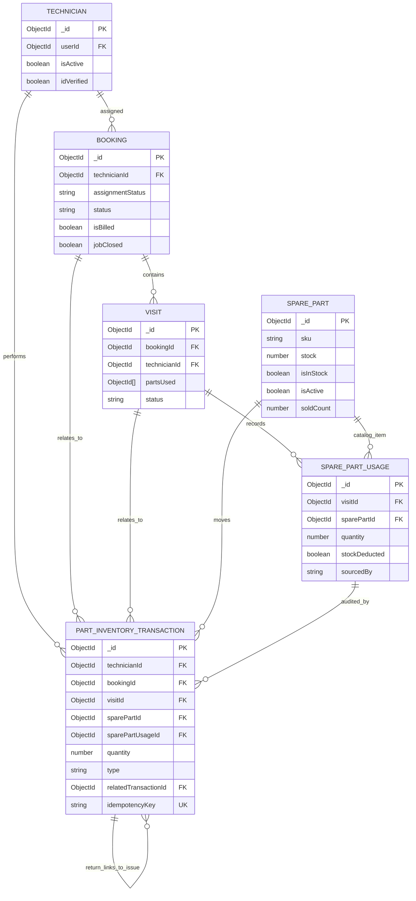

# P2-08 — Service Part Requests and Returns

## 1. Introduction

### Purpose

This document describes the implemented backend design for tracking inventory parts issued to technician jobs, returned by technicians, and queried through technician-only transaction history.

### Scope and goals

- Deduct catalog stock immediately when an inventory part is issued to a job.
- Record ISSUE and RETURN movements in one append-only application ledger.
- Keep the job's `SparePartUsage.quantity` equal to the net quantity retained for billing.
- Restore stock for partial and full returns without changing shop sales counters.
- Make stock, usage, visit links, booking audit history, and ledger writes atomic within MongoDB transactions.
- Expose each technician's own transaction history with bounded pagination.

### Out of scope

- Admin approval or review of issues and returns.
- Stock reservations, purchase ordering, or shop-sale changes.
- Frontend behavior or technician-client changes.
- A new technician role or a separate transaction-history model.
- Returning legacy inventory usages that have no P2-08 ISSUE ledger record.

## 2. Existing system architecture

### NestJS modules and ownership

- `AppModule` connects Mongoose using `MONGO_URI` (falling back to `mongodb://localhost:27017/fixxer` if unset) and imports both `VisitsModule` and `TechnicianPlatformModule`.
- `VisitsModule` registers `Visit`, `SparePartUsage`, `Booking`, `SparePart`, and `PartInventoryTransaction`; it provides and exports `VisitsService`.
- `TechnicianPlatformModule` imports `VisitsModule` and registers the transaction schema for its model injection. It owns `TechnicianJobsController` and `JobSheetService`.
- `TechnicianJobsController` delegates job-sheet part writes to `JobSheetService`, which coordinates job-sheet rules and calls `VisitsService` for inventory ledger operations.
- `VisitsService` owns transaction persistence, atomic stock/usage updates, visit links, and booking change-history writes.
- `BookingsService` recalculates invoices and settlement snapshots from visits and their `SparePartUsage` records.
- `WarrantiesService` registers part warranties from usage records with serial and warranty metadata.

### Authentication and authorization

All routes in `TechnicianJobsController` have class-level `AuthGuard('jwt')`, `TechnicianGuard`, and `RequireActiveTechnician` metadata.

`TechnicianGuard` requires a JWT user, checks `request.user.role === 'TECHNICIAN'`, resolves the technician profile through `TechniciansService.findByUserId(user.userId)`, and places it on `request.technician`. With `RequireActiveTechnician`, it also rejects a profile unless both `isActive` and `idVerified` are true. `CurrentTechnician` reads this resolved profile; the part-history controller passes its `_id` to the query service. No technician ID is accepted from request query parameters.

ISSUE and RETURN additionally validate booking assignment inside their transaction. The booking's `technicianId` must resolve to the authenticated technician, assignment must be `ACCEPTED`, and the booking must be editable, not billed, closed, or locked. The visit must belong to the booking.

`Visit.technicianId` is stored, but these ISSUE/RETURN service checks use the assigned `Booking.technicianId` as the authorization source and check that the visit's `bookingId` matches; they do not separately compare `Visit.technicianId` to the current technician.

## 3. Database design

Mongoose schemas use ObjectId references; MongoDB does not enforce foreign keys. Schemas with `{ timestamps: true }` receive `createdAt` and `updatedAt`.

### Collections and relevant fields

| Model | Relevant fields | P2-08 role |
|---|---|---|
| `PartInventoryTransaction` | `technicianId`, `bookingId`, `visitId`, `sparePartId`, `sparePartUsageId`, `quantity`, `type`, `relatedTransactionId`, `idempotencyKey`, timestamps | Append-only record for each inventory movement. `type` is `ISSUE` or `RETURN`; a RETURN points to its originating ISSUE. |
| `SparePart` | `sku`, `partNumber`, `name`, `price` (paise), `stock`, `isInStock`, `isActive`, `warrantyMonths`, `soldCount`, timestamps | Catalog source and on-hand inventory balance. P2-08 changes `stock` and `isInStock`; it does not change `soldCount`. |
| `SparePartUsage` | `visitId`, `isThirdParty`, `sparePartId`, `quantity`, `stockDeducted`, `sourcedBy`, `cost`, `partName`, serial/warranty fields, timestamps | Job-level line used for invoice and settlement calculation. For P2-08 inventory lines, `quantity` is net units retained after returns. |
| `Visit` | `bookingId`, `technicianId`, `visitOrder`, `status`, `partsUsed[]`, timestamps | Job visit containing references to part-usage lines. |
| `Booking` | `userId`, `technicianId`, `assignmentStatus`, `status`, `isBilled`, `jobClosed`, `sheetLockedAt`, `visits[]`, `changeHistory[]`, `invoiceData`, timestamps | Job assignment/editability gate; stores visit references, invoice totals, and append-style audit events. |
| `Technician` | `userId`, `name`, `phone`, `isActive`, `idVerified`, `availabilityStatus`, timestamps | Profile resolved from the authenticated JWT subject by `TechnicianGuard`. The role itself is checked on the JWT user, not stored as this schema's role field. |

### Indexes and enums

`PartInventoryTransaction` declares indexes for `technicianId`, `bookingId`, `visitId`, `sparePartId`, `sparePartUsageId`, and `type`. It also declares:

- A unique index on `idempotencyKey`, preventing two committed movements from sharing a key.
- A compound `{ technicianId: 1, createdAt: -1 }` index for technician history ordering/filtering.
- A compound `{ relatedTransactionId: 1, type: 1 }` index for movement linkage and return aggregation.

The transaction schema allows only `ISSUE` and `RETURN`. Quantity has a minimum of one and an integer validator. Transaction writes in application flows insert documents; those flows do not update or delete ledger records. Append-only behavior is enforced by application paths, not by a database-level immutable collection policy.

`SparePartUsage` has a unique sparse serial-number index (`spare_part_usage_serial_unique`). It has no unique ISSUE-transaction relationship constraint. `SparePart` includes its own catalog/search indexes; its `soldCount` is independent of technician inventory issues and returns.

### Entity relationships



There is one ISSUE transaction for each new inventory usage created by the ISSUE flow. A usage can have zero or more RETURN transactions. Each RETURN references the original ISSUE in `relatedTransactionId`; the ISSUE transaction is retained when parts are returned.

## 4. ISSUE workflow

The existing endpoint remains the entry point for both inventory and self-sourced part lines. Inventory flow is selected when `isThirdParty` is false/falsy; self-sourced behavior continues through the existing non-inventory path and does not create a P2-08 transaction.

1. `TechnicianJobsController.addPart` receives the job ID, visit ID, body, and technician from `CurrentTechnician`.
2. `JobSheetService.addPart` requires an inventory quantity that converts to a positive integer and a valid spare-part ObjectId. It looks up a prior ISSUE by idempotency key before stock/job mutable checks. A matching retry returns the original usage; a mismatched payload conflicts.
3. If no prior issue exists, the job-sheet service checks booking ownership/editability, visit-to-booking ownership, active part status, and preliminary available stock. It converts catalog paise pricing to rupees and resolves serial/warranty values.
4. `VisitsService.issueInventoryPartToVisit` validates quantity/key and checks idempotency again. It opens a Mongoose session and runs the remaining writes inside `session.withTransaction()`.
5. Inside the transaction, it revalidates booking assignment/editability and visit ownership. It conditionally decrements stock with a filter requiring an active part and `stock >= quantity`; it updates `isInStock` in the same session.
6. `addSparePartToVisit` creates an inventory `SparePartUsage` with `stockDeducted: true`, adds the usage ID to `Visit.partsUsed`, and writes a parts event to `Booking.changeHistory` using the transaction session.
7. An ISSUE ledger record is inserted in the same transaction. Commit makes stock, usage, visit link, booking audit event, and ISSUE record visible together.
8. After commit, `JobSheetService.afterPartChange` repairs legacy catalog cost values, increments the job-sheet revision, and regenerates invoice data. These derived updates are outside the inventory transaction.

If no issue idempotency key is supplied, `JobSheetService` generates a fresh ObjectId string. This preserves compatibility, but a client retry without a stable key does not receive retry deduplication.

```mermaid
sequenceDiagram
    actor Tech as Technician
    participant C as TechnicianJobsController
    participant J as JobSheetService
    participant V as VisitsService
    participant DB as MongoDB (replica set)
    participant B as BookingsService

    Tech->>C: POST job/visit/parts + JWT
    C->>J: addPart(jobId, technicianId, visitId, body)
    J->>J: Validate positive integer quantity and part ID
    J->>V: findExistingInventoryIssue(stable key, payload)
    alt Matching prior ISSUE
        V->>DB: Find key; verify technician/job/visit/part/quantity
        DB-->>V: Existing transaction and usage
        V-->>J: Original usage
        J-->>C: Original successful result
    else No prior ISSUE
        J->>J: Validate assigned editable job, visit, part, preliminary stock
        J->>V: issueInventoryPartToVisit(...)
        V->>DB: Start session and transaction
        V->>DB: Recheck key, assignment, job editability, visit ownership
        V->>DB: Conditional stock decrement (stock >= quantity)
        V->>DB: Create usage; link to visit; append booking audit event
        V->>DB: Insert ISSUE ledger record
        DB-->>V: Commit
        V-->>J: New usage
        J->>B: afterPartChange; regenerate invoice
        J-->>C: Usage response
    end
```

## 5. RETURN workflow

The route identifies a usage line. It does not accept a spare-part ID from the client; the part and originating ISSUE are derived from the stored usage and ledger.

1. `TechnicianJobsController.returnPart` receives job, visit, and usage IDs plus `ReturnInventoryPartDto`; technician ID comes from `CurrentTechnician`.
2. `JobSheetService.returnPart` delegates to `VisitsService.returnInventoryPart`. A successful first return triggers the existing invoice/job-sheet refresh; an idempotent replay refreshes invoice data without repeating stock or usage writes.
3. `returnInventoryPart` requires a positive integer quantity, valid ObjectId references, and a non-empty idempotency key no longer than 200 characters. It checks for a prior transaction by key before checking current job state. Matching payload replays; key reuse with a different technician, job, visit, usage, or quantity conflicts.
4. Inside a MongoDB transaction, the service verifies the booking is still assigned/accepted/editable for the technician and that the visit belongs to the job. The usage must be a stock-deducted `INVENTORY` usage with a spare-part reference.
5. The service finds the matching ISSUE transaction and sums prior RETURN quantities linked to it. Outstanding quantity is `issue.quantity - sum(prior returns)`. It also requires `SparePartUsage.quantity` to equal this outstanding amount; mismatch returns a conflict rather than silently diverging ledger and billing state.
6. Requests larger than outstanding are rejected. The usage update is conditional on its quantity being at least the requested amount and decrements the quantity by the return amount.
7. The service increments `SparePart.stock`, sets `isInStock` true, inserts an append-only RETURN linked to the ISSUE, and appends a booking audit event in the same session.
8. Commit atomically applies usage, stock, ledger, and booking-history changes. Usage remains in `Visit.partsUsed`, including at quantity zero. A full return therefore preserves its history while contributing no billable quantity.

```mermaid
sequenceDiagram
    actor Tech as Technician
    participant C as TechnicianJobsController
    participant J as JobSheetService
    participant V as VisitsService
    participant DB as MongoDB (replica set)
    participant B as BookingsService

    Tech->>C: POST job/visit/parts/usage/returns + quantity + key
    C->>J: returnPart(jobId, technicianId, visitId, usageId, body)
    J->>V: returnInventoryPart(...)
    V->>DB: Lookup idempotency key
    alt Matching prior RETURN
        DB-->>V: Existing RETURN and current usage
        V-->>J: replayed = true
        J->>B: Regenerate invoice data
        J-->>C: Original RETURN and usage result
    else New return
        V->>DB: Start session and transaction
        V->>DB: Validate assigned editable job, visit, inventory usage
        V->>DB: Read ISSUE and prior linked RETURN quantities
        V->>V: outstanding = ISSUE quantity - prior returns
        V->>DB: Conditional usage quantity decrement
        V->>DB: Increment stock and set isInStock
        V->>DB: Insert RETURN linked to ISSUE
        V->>DB: Append booking change-history event
        DB-->>V: Commit
        V-->>J: usage with net quantity; replayed = false
        J->>B: afterPartChange; regenerate invoice data
        J-->>C: RETURN and updated usage
    end
```

The legacy part-deletion path rejects a usage with an ISSUE ledger record. Inventory-issued parts must be returned through this flow; deleting the usage would otherwise erase the relationship behind an append-only ledger.

The ISSUE/RETURN booking audit events set `actorRole` to `TECHNICIAN` and pass the technician profile ID as `actorId`. The `BookingChangeHistoryEntry` schema declares `actorId` as a reference to `User`; the current write path does not translate that ID to the linked user ID.

## 6. Transaction history API

### Endpoint and authorization

`GET /v1/jobs/part-transactions` is a `TechnicianJobsController` route. It inherits JWT authentication, `TechnicianGuard`, and the active/verified technician requirement from the controller class.

The handler calls `VisitsService.listPartInventoryTransactions(technician._id.toString(), page, limit)`. The filter is always `{ technicianId: authenticatedTechnicianId }`. The controller has no technician-ID query parameter, and the response does not include the technician ID.

### Pagination and ordering

- `page`: default `1`; must parse as a safe positive integer.
- `limit`: default `20`; must parse as a safe positive integer and be at most `100`.
- Sort: `{ createdAt: -1, _id: -1 }`, so newest transactions come first with a deterministic tie-breaker.
- Response includes `total`, `page`, `limit`, and `totalPages` (`0` when no results).

### Returned data

Each `data` entry has `transactionId`, `type`, `quantity`, `sparePart`, `booking`, `visit`, `relatedIssue`, and `timestamp`. References are populated with a restricted field selection. `relatedIssue` is null for ISSUE records and contains the original ISSUE reference for RETURN records.

```mermaid
sequenceDiagram
    actor Tech as Technician
    participant JWT as JWT AuthGuard
    participant Guard as TechnicianGuard
    participant TS as TechniciansService
    participant C as TechnicianJobsController
    participant V as VisitsService
    participant DB as MongoDB

    Tech->>JWT: GET part-transactions with bearer token
    JWT->>Guard: request.user from validated JWT
    Guard->>Guard: Require role TECHNICIAN
    Guard->>TS: findByUserId(userId)
    TS-->>Guard: Technician profile
    Guard->>Guard: Require active and ID verified
    Guard-->>C: request.technician assigned
    C->>V: listPartInventoryTransactions(technician._id, page, limit)
    V->>V: Validate pagination; cap limit at 100
    V->>DB: Filter technicianId; sort newest; skip/limit; populate references
    V->>DB: Count same technician filter
    DB-->>V: Page of transactions and total
    V-->>C: Data plus pagination metadata
    C-->>Tech: 200 response
```

## 7. API contracts

All routes below are under `TechnicianJobsController` and require `Authorization: Bearer <JWT>` for a technician profile that is active and ID-verified. JSON bodies use `Content-Type: application/json`.

### ISSUE (existing job-sheet parts route)

**Method and URL:** `POST /v1/jobs/:jobId/visits/:visitId/parts`

**Example inventory request:**

```http
Authorization: Bearer <technician-jwt>
Content-Type: application/json
```

```json
{
  "isThirdParty": false,
  "sparePartId": "66a100000000000000000101",
  "quantity": 2,
  "idempotencyKey": "mobile-issue-66a100000000000000000201",
  "serialNumber": "MOTOR-009812"
}
```

`idempotencyKey` is optional on this existing endpoint for compatibility. If omitted, a new server-side key is generated for that request; retry protection is therefore only reliable when the client supplies and reuses a stable key. `serialNumber` is required when the resolved warranty duration is greater than zero. Other existing usage fields (such as `installedAt`, `warrantyMonths`, and replacement metadata) remain accepted by the service path. `isThirdParty: true` preserves the self-sourced path and does not create an inventory transaction.

**Successful response:** the endpoint returns the created `SparePartUsage` document (not the ISSUE ledger document).

```json
{
  "_id": "66a100000000000000000301",
  "visitId": "66a100000000000000000201",
  "isThirdParty": false,
  "sparePartId": "66a100000000000000000101",
  "quantity": 2,
  "stockDeducted": true,
  "partName": "Motor assembly",
  "cost": 757.5,
  "sourcedBy": "INVENTORY",
  "createdAt": "2026-11-14T10:30:00.000Z",
  "updatedAt": "2026-11-14T10:30:00.000Z"
}
```

**Errors:** `400` for invalid quantity/part ID, insufficient stock, locked/non-editable job, or visit mismatch; `403` for a job not assigned/accepted to the technician; `404` for missing/inactive part or missing job; `409` when an idempotency key is reused with a different payload. Exact Nest exception messages vary by validation path.

### RETURN

**Method and URL:** `POST /v1/jobs/:jobId/visits/:visitId/parts/:usageId/returns`

**Request body:** `ReturnInventoryPartDto` declares integer/minimum quantity and non-empty string/max-200-character key constraints. The service also performs the effective quantity/key checks before writes.

```json
{
  "quantity": 2,
  "idempotencyKey": "mobile-return-66a100000000000000000401"
}
```

**Successful response:**

```json
{
  "transaction": {
    "_id": "66a100000000000000000501",
    "technicianId": "66a100000000000000000601",
    "bookingId": "66a100000000000000000701",
    "visitId": "66a100000000000000000201",
    "sparePartId": "66a100000000000000000101",
    "sparePartUsageId": "66a100000000000000000301",
    "quantity": 2,
    "type": "RETURN",
    "relatedTransactionId": "66a100000000000000000801",
    "idempotencyKey": "mobile-return-66a100000000000000000401",
    "createdAt": "2026-11-14T10:40:00.000Z",
    "updatedAt": "2026-11-14T10:40:00.000Z"
  },
  "usage": {
    "_id": "66a100000000000000000301",
    "visitId": "66a100000000000000000201",
    "isThirdParty": false,
    "sparePartId": "66a100000000000000000101",
    "quantity": 3,
    "stockDeducted": true,
    "sourcedBy": "INVENTORY"
  }
}
```

The `transaction.quantity` is the amount returned in this operation; `usage.quantity` is the net amount retained for the job. A repeated matching request returns the original transaction and current usage.

**Errors:** `400` for invalid quantity/reference, usage not issued from inventory, issue ledger missing, visit mismatch, or return larger than outstanding; `403` for unassigned/unaccepted/locked job; `404` for missing job/part; `409` for idempotency payload mismatch or inconsistent usage-vs-ledger outstanding quantity. A standalone MongoDB deployment cannot execute this transaction and does not get a non-atomic fallback.

### Technician transaction history

**Method and URL:** `GET /v1/jobs/part-transactions?page=1&limit=20`

No request body. Only `page` and `limit` are read; a query parameter such as `technicianId` is ignored and never used to construct the database filter.

**Successful response:**

```json
{
  "data": [
    {
      "transactionId": "66a100000000000000000501",
      "type": "RETURN",
      "quantity": 2,
      "sparePart": {
        "id": "66a100000000000000000101",
        "name": "Motor assembly",
        "sku": "MOTOR-001",
        "partNumber": "MTR-01",
        "price": 75750
      },
      "booking": {
        "id": "66a100000000000000000701",
        "status": "IN_PROGRESS",
        "serviceId": "66a100000000000000000901",
        "createdAt": "2026-11-14T09:00:00.000Z"
      },
      "visit": {
        "id": "66a100000000000000000201",
        "status": "IN_PROGRESS",
        "visitOrder": 1
      },
      "relatedIssue": {
        "id": "66a100000000000000000801",
        "type": "ISSUE",
        "quantity": 5,
        "createdAt": "2026-11-14T10:30:00.000Z"
      },
      "timestamp": "2026-11-14T10:40:00.000Z"
    }
  ],
  "total": 4,
  "page": 1,
  "limit": 20,
  "totalPages": 1
}
```

ISSUE rows have `relatedIssue: null`. Empty history returns `data: []`, `total: 0`, and `totalPages: 0`. Invalid/non-positive/non-integer values produce `400`; a `limit` above `100` produces `400`. Missing/invalid JWT produces `401`; non-technician, missing profile, inactive, or unverified technician produces `403` through the existing guards.

## 8. Transaction and concurrency strategy

### Replica-set requirement

MongoDB multi-document transactions require a replica set (or sharded cluster). P2-08 does not catch transaction-not-supported errors and continue with non-atomic writes. Local Docker is configured as a one-member replica set; checked-in production Compose remains standalone until an explicit production conversion is completed.

### Mongoose sessions and atomic writes

Both `issueInventoryPartToVisit` and `returnInventoryPart` call `connection.startSession()` and wrap related writes in `session.withTransaction()`. Queries and mutations that form the ledger operation receive that session. A thrown validation, stock, usage, or ledger error aborts the transaction; the session is ended in `finally`.

Issue uses a conditional stock update filter `{ _id, isActive: true, stock: { $gte: quantity } }` with `$inc: { stock: -quantity }`. This makes the on-hand balance check part of the mutation and prevents two different requests from overspending the same stock. An update to `isInStock`, usage creation, visit linking, booking audit history, and ISSUE creation follow within the same transaction.

Return calculates outstanding units from the ISSUE ledger and prior RETURN rows. It compares that ledger-derived outstanding amount to `SparePartUsage.quantity`, then conditionally updates the usage only when its quantity is at least the requested amount. Competing sessions updating the same usage/stock documents conflict and are retried/aborted by MongoDB transaction behavior; after retry, an excess return fails outstanding validation. Stock restore and RETURN/audit writes are committed with the usage decrement.

### Idempotency

- The transaction collection has a unique `idempotencyKey` index shared by ISSUE and RETURN operations.
- ISSUE keys are checked before mutable validation and again inside the transaction. A matching payload replays the existing usage; a mismatched payload conflicts. A duplicate-key race is followed by a lookup to return the committed usage if it matches.
- ISSUE key is optional at the existing endpoint. The service creates a fresh key when absent, which means retries without a caller-stable key are not deduplicated.
- RETURN keys are required by the input contract and checked before mutable validation and within the transaction. Matching requests replay the original ledger row/current usage. Different payloads, including another technician, conflict without returning another technician's record.
- The unique index is the final guard against two records with the same key.

### Rollback and verification scope

The integration tests use `MongoMemoryReplSet` and deliberately throw after stock/usage/visit/booking updates but before ledger insertion. They assert rollback of affected state for both ISSUE and RETURN. This verifies transaction behavior in the test replica set. It does not verify the deployed production MongoDB topology.

## 9. Billing and warranty integration

### Invoice and billable quantities

`BookingsService.generateInvoiceData` reads populated usages from visits. It multiplies unit cost by each usage quantity to compute `partsTotal` and invoice lines. A RETURN decrements the same usage quantity, so partial returns reduce the line while preserving the line's original unit cost. Explicit zero-quantity usages are skipped so fully returned inventory contributes no invoice line and is not accidentally treated as one unit by legacy `quantity || 1` defaults.

After the first return, `JobSheetService.afterPartChange` repairs legacy catalog cost representations, increments job-sheet revision, and regenerates invoice data. On a replay, the service regenerates invoice data without performing another stock or quantity mutation. These invoice writes happen after the return transaction; they are not part of the inventory ledger transaction.

### Warranty registration

`WarrantiesService.registerPartsForBooking` skips a usage whose explicit quantity is zero. Thus a fully returned line with serial/warranty metadata does not get a newly registered part warranty when completion registers warranties. A partial return leaves the same usage and warranty metadata on the remaining line; the current model associates warranty information with a usage/serial, not with individual units.

### Settlements

Settlement calculation consumes `SparePartUsage.quantity`. `partLineAmount` treats an explicit zero quantity as zero, so partial returns lower inventory parts total, commission, and split; a full return contributes zero. Self-sourced parts and their platform fees remain outside the inventory return path.

### Visit completion and shop behavior

`VisitsService.updateStatus(..., { status: 'COMPLETED' })` deducts stock only for inventory usages whose `stockDeducted` is false. ISSUE creates usage with `stockDeducted: true`, and RETURN keeps it true, preventing a later completion from deducting the net quantity again. Returns only adjust `stock` and `isInStock`; `SparePart.soldCount`, shop checkout, and part-order stock flows are not called or changed.

## 10. Error handling and security

| Condition | Result |
|---|---|
| Missing/invalid JWT | `401 Unauthorized` from JWT guard |
| User role is not TECHNICIAN, technician profile missing, inactive, or not ID-verified | `403 Forbidden` from `TechnicianGuard`/active requirement |
| Technician is not assigned to the booking or assignment is not accepted | `403 Forbidden` |
| Job is billed, closed, locked, or outside editable status | `403`/`400` according to the check path |
| ISSUE quantity is missing, non-positive, or not an integer after conversion | `400 Bad Request` |
| Issue part ID invalid | `400 Bad Request` |
| Active spare part does not exist | `404 Not Found` |
| Insufficient issue stock | `400 Bad Request`; no partial update commits |
| Existing idempotency key has a different payload | `409 Conflict` |
| RETURN usage is self-sourced, not stock-deducted, missing, or has no ISSUE ledger row | `400 Bad Request` |
| Return exceeds issue quantity less prior returns | `400 Bad Request` |
| Usage quantity and ledger outstanding disagree | `409 Conflict` |
| History page/limit invalid or limit above 100 | `400 Bad Request` |

History data is isolated by a server-resolved `technicianId` filter. Return idempotency lookup checks technician ownership before returning the transaction/usage result. The endpoint returns restricted populated fields rather than full booking/contact or catalog documents.

`ReturnInventoryPartDto` declares `class-validator` decorators, but `src/main.ts` currently does not install a global `ValidationPipe`. Quantity and key checks in `VisitsService.returnInventoryPart` are therefore the effective write validation. The DTO metadata should not be treated as proof that a global DTO validation pipe is active. Enforcing DTO type validation at bootstrap is a future improvement.

## 11. Testing strategy

Transaction integration tests use `MongoMemoryReplSet.create({ replSet: { count: 1 } })` in `src/visits/visits.service.spec.ts`.

| Area | Verified behavior and test location |
|---|---|
| ISSUE | Success creates usage/ISSUE and deducts once; strict quantity; inactive/missing part; insufficient stock; wrong technician; `src/visits/visits.service.spec.ts` |
| ISSUE idempotency | Exhausted-stock retry returns original usage; payload mismatch and cross-technician key isolation; same-key concurrent issue deduplication; `visits.service.spec.ts`, `job-sheet.service.spec.ts` |
| ISSUE concurrency | Different idempotency keys cannot overspend limited stock; `visits.service.spec.ts` |
| ISSUE rollback | Forced ledger creation failure proves stock, usage, visit link, booking history, and ledger roll back; `visits.service.spec.ts` |
| RETURN | Partial/full/sequential return, quantity validation, over-return, inventory-only restriction, assigned-technician check; `visits.service.spec.ts` |
| RETURN idempotency/concurrency | Sequential retry, same key with changed payload, cross-technician key isolation, concurrent same-key replay, and concurrent different-key over-return; `visits.service.spec.ts` |
| RETURN rollback | Forced RETURN ledger insert failure proves stock, usage, ledger and booking history return to the pre-operation state; `visits.service.spec.ts` |
| Return/legacy behavior | Visit completion does not deduct returned stock a second time; ledger-backed usage cannot be deleted through old part removal; `visits.service.spec.ts` |
| History | ISSUE and RETURN rows, related ISSUE, populated references, newest-first order, pagination, empty result, invalid pagination and technician isolation; `visits.service.spec.ts` |
| Route authorization | Controller forwards `CurrentTechnician` ID and has JWT/TechnicianGuard route metadata; `technician-jobs.controller.spec.ts` |
| Job-sheet integration | Return delegates to ledger service and refreshes invoice on retry; `job-sheet.service.spec.ts` |
| Billing | Net retained quantity is invoiced; full-return quantity zero is omitted; `bookings.invoice-gen.spec.ts` |
| Warranty | Full-return quantity zero is skipped during warranty registration; `warranties.service.spec.ts` |

Latest reported full verification for this codebase: **43 suites passed, 275 tests passed**, with build, TypeScript, and `git diff --check` passing. This LLD-writing task does not rerun that suite.

## 12. Deployment requirements

### Local development configuration

The checked-in root `docker-compose.yml` uses MongoDB 7 with:

- `mongod --replSet rs0 --bind_ip_all`
- A `mongo_data` volume
- `deploy/init-mongo-replica-set.js`, which initializes `rs0` with member `127.0.0.1:27017` when the data directory is new/uninitialized
- A health check that waits for `db.hello().isWritablePrimary`

The `.env.example` URI is `mongodb://127.0.0.1:27017/fixxer?replicaSet=rs0`. Since `src/app.module.ts`'s fallback URI has no `replicaSet` option, local execution should set `MONGO_URI` explicitly to the replica-set URI.

Start and inspect local MongoDB:

```sh
docker compose up -d mongo
docker compose ps mongo
docker compose exec mongo mongosh --quiet --eval 'printjson(rs.status().members.map(m => ({ name: m.name, stateStr: m.stateStr })))'
docker compose exec mongo mongosh --quiet --eval 'printjson(db.hello())'
```

Expected replica-set state is one `PRIMARY` member and `isWritablePrimary: true`. On a pre-existing data volume, the init script does not rerun. After backing up local data and confirming the set is not already initialized, the documented one-time initialization command is:

```sh
docker compose exec mongo mongosh --quiet --eval 'rs.initiate({_id:"rs0",members:[{_id:0,host:"127.0.0.1:27017"}]})'
```

Do not delete the data volume as a way to enable transactions.

### Production requirements and status

The checked-in `deploy/docker-compose.prod.yml` currently starts standalone `mongod` without `--replSet`; `deploy/env.backend.production.example` has a standalone URI. Production has not been verified/configured for P2-08 transactions and must be treated as unsupported until migrated. Do not reuse the local `127.0.0.1:27017` replica-set member address blindly for a different API/database topology.

Before production enablement:

1. Back up production data and test restoring it.
2. Plan a maintenance window and convert the existing MongoDB data directory to a single-node or production-appropriate replica set without dropping data.
3. Configure every API instance with a `MONGO_URI` containing the correct `replicaSet` option while preserving production auth/TLS settings.
4. Ensure the replica-set member hostname is reachable from the MongoDB process and all API clients.
5. Verify `rs.status()` has a writable `PRIMARY` and run committed and aborted multi-document transaction smoke checks before enabling ISSUE/RETURN traffic.

The integration suite runs against `mongodb-memory-server`'s replica-set mode and has passed transaction commit/rollback tests. That is test-environment evidence only. Docker runtime validation and production topology/runtime validation have not been performed as part of the reported P2-08 verification. The root local Compose configuration is checked in; production Compose remains standalone.

## 13. Future improvements

- Require stable client-generated ISSUE idempotency keys once every existing caller can send them; current compatibility fallback generates a new key on every keyless request.
- Install a global `ValidationPipe` or explicit request parsing so DTO type decorators are enforced for all incoming return bodies.
- Consider cursor-based history pagination if a technician's ledger becomes large; current implementation uses indexed filter plus offset pagination.
- Consider database-level protection against manual ledger updates/deletes if direct database writers must be prevented; current append-only guarantee is implemented by application write paths.
- Align booking change-history actor references with `BookingChangeHistoryEntry.actorId`'s `User` reference, or adjust the audit schema to represent technician actors explicitly.
- Decide whether visit-level technician ownership should also be checked alongside the assigned booking technician if visit assignments can diverge from booking assignments.
- Consider a serial-per-unit model if one usage quantity may represent multiple individually warrantied serial-numbered parts. Current warranty metadata is attached to one usage line.
- Reconcile invoice refresh with the inventory transaction or add a durable retry mechanism. ISSUE invoice refresh is post-commit and a matching issue preflight returns the usage directly; a failure between commit and refresh can leave derived invoice data stale until another recalculation. RETURN replay does explicitly regenerate invoice data.
- Migrate or explicitly resolve legacy inventory usages without an ISSUE transaction before offering returns for those historical lines; current return validation intentionally requires an ISSUE ledger record.
