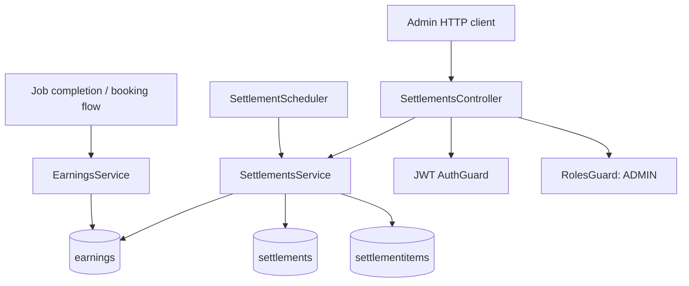
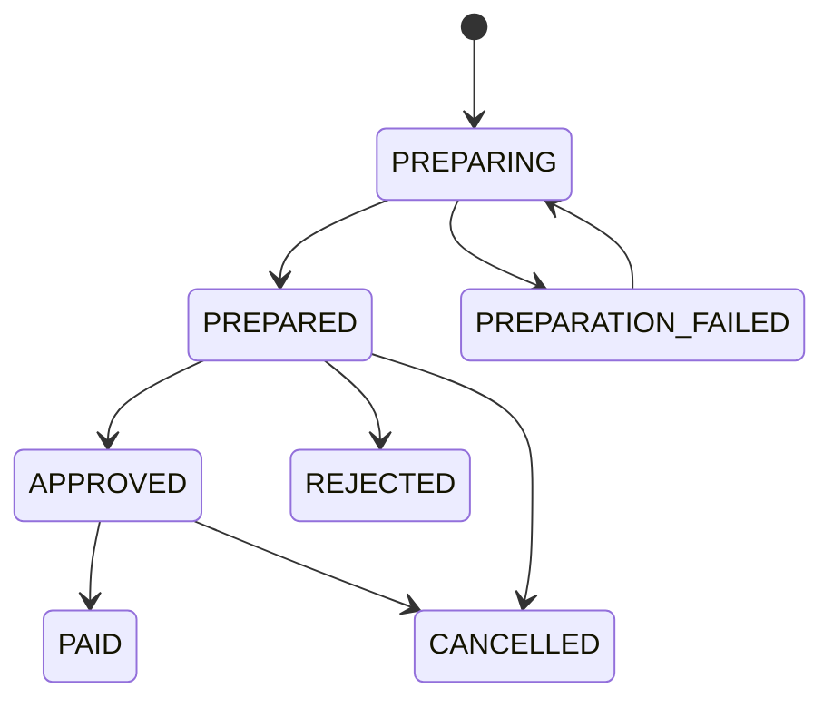
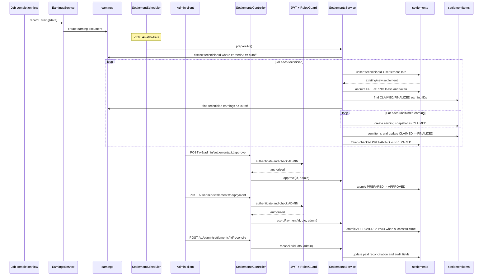

# P2-10 Technician Settlement Reconciliation

## 1. Feature overview

P2-10 prepares technician settlements from persisted earning records. It groups eligible earnings by technician, creates one settlement for the Indian business date, snapshots the included earnings as settlement items, and supports an administrator-controlled lifecycle through approval, payment, and reconciliation.

The implementation is backend-only. No technician or admin settlement frontend is implemented in this codebase.

### Objectives

- Include all earnings up to the preparation cutoff, including older outstanding earnings.
- Ensure an earning is not actively claimed by two settlements.
- Make repeated and concurrent preparation safe.
- Recover abandoned preparation after a lease expires.
- Preserve historical earning documents.
- Require explicit verified payment success before marking a settlement `PAID`.
- Restrict settlement operations to authenticated administrators.
- Record important lifecycle events in an audit trail.

## 2. Technology stack

- Node.js and TypeScript
- NestJS
- Mongoose
- MongoDB / MongoDB Atlas in production
- `@nestjs/schedule` for cron execution
- `class-validator` and NestJS `ValidationPipe` for request validation
- Passport JWT authentication and a NestJS role guard
- Jest, Supertest, and MongoDB Memory Server for tests

The implementation does not use MongoDB transactions. Correctness is based on unique indexes, atomic `findOneAndUpdate`/`updateOne` operations, duplicate-key handling, and preparation leases.

## 3. Architecture



### Component responsibilities

- `EarningsService`: creates and reads earning records.
- `SettlementsService`: owns preparation, item claiming, lifecycle transitions, payment, reconciliation, validation, and audit updates.
- `SettlementsController`: exposes administrator settlement endpoints.
- `SettlementScheduler`: invokes nightly preparation.
- `Settlement` schema: stores one settlement batch and its lifecycle/payment metadata.
- `SettlementItem` schema: stores the earning snapshots included in a batch.
- `Earning` schema: stores the source earning ledger.
- `RolesGuard`: enforces the `ADMIN` role after JWT authentication has populated `request.user`.

## 4. Relevant files

### Settlement implementation

| File | Responsibility |
|---|---|
| `src/technician-platform/settlements/settlements.service.ts` | Preparation, claiming, recovery, lifecycle, payment, reconciliation, and validation |
| `src/technician-platform/settlements/settlements.controller.ts` | Admin HTTP routes |
| `src/technician-platform/settlements/settlements.dto.ts` | Request DTO validation |
| `src/technician-platform/settlements/settlement.scheduler.ts` | Nightly cron trigger |
| `src/technician-platform/settlements/settlements.module.ts` | Registers models, providers, and controller |
| `src/technician-platform/settlements/schemas/settlement.schema.ts` | Settlement and audit schema |
| `src/technician-platform/settlements/schemas/settlement-item.schema.ts` | Settlement item schema and duplicate-protection indexes |

### Source earnings and module wiring

| File | Responsibility |
|---|---|
| `src/technician-platform/schemas/earning.schema.ts` | Source earning schema |
| `src/technician-platform/earnings/earnings.service.ts` | Earning creation and history |
| `src/technician-platform/job-completion/job-completion.service.ts` | Creates earning lines after job completion |
| `src/technician-platform/settlement.ts` | Calculates technician payout and produces earning lines |
| `src/technician-platform/technician-platform.module.ts` | Imports `SettlementsModule` |
| `src/app.module.ts` | Imports `TechnicianPlatformModule` |
| `src/auth/guards/roles.guard.ts` | Enforces required roles |
| `src/auth/decorators/roles.decorator.ts` | Defines role metadata |

### Tests

| File | Coverage |
|---|---|
| `src/technician-platform/settlement.spec.ts` | Payout calculation and payout-line behavior |
| `src/technician-platform/settlements/settlements.service.spec.ts` | MongoDB preparation, idempotency, concurrency, recovery, older earnings, lifecycle, payment, and authorization metadata |
| `src/technician-platform/settlements/settlements.controller.spec.ts` | Real NestJS HTTP controller, validation, admin authorization, API idempotency, lifecycle, and payment confirmation |
| `src/technician-platform/settlements/settlement.scheduler.spec.ts` | Cron metadata and delegation to `prepareAll()` |

## 5. MongoDB collection and schema design

### `earnings`

Defined by `EarningSchema`.

Important fields:

- `technicianId`: required ObjectId, indexed
- `bookingId`: optional ObjectId
- `amount`: required number
- `type`: `LABOUR`, `PARTS`, `BONUS`, `JOINING_FEE_REFUND`, or `SELF_PART_FEE`
- `paymentMethod`: `CASH`, `UPI`, `CARD`, or `ONLINE`
- `description`: optional string
- `earnedAt`: required date

Preparation reads these records and does not rewrite or delete them.

### `settlements`

Defined by `SettlementSchema`, with timestamps.

Important fields:

- `technicianId`
- `settlementDate`: `YYYY-MM-DD` Indian business date
- `cutoffAt`: exact preparation cutoff
- `totalEarnings`
- `adjustments`
- `netPayable`
- `currency`
- `status`
- `paymentStatus`
- `reconciliationStatus`
- approval fields: `approvedBy`, `approvedAt`
- rejection fields: `rejectedBy`, `rejectedAt`, `rejectionReason`
- payment fields: `paymentReference`, `paymentMethod`, `paymentInitiatedAt`, `paidAt`, `paymentFailureReason`
- preparation failure field: `preparationFailureReason`
- reconciliation fields: `reconciledAt`, `reconciledBy`, `reconciliationNotes`
- preparation coordination fields: `preparationToken`, `preparationLeaseUntil`
- `auditTrail`

Indexes:

```text
unique { technicianId: 1, settlementDate: 1 }
{ status: 1, settlementDate: -1 }
{ paymentStatus: 1, settlementDate: -1 }
```

The unique compound index makes repeated preparation idempotent at the batch level.

### `settlementitems`

Defined by `SettlementItemSchema`, with timestamps.

Important fields:

- `settlementId`
- `earningId`
- `technicianId`
- optional `bookingId`
- `amount`: snapshot of the earning amount
- `earningType`
- `description`
- `earnedAt`
- `customerPaymentMethod`
- `claimStatus`: `CLAIMED`, `FINALIZED`, or `RELEASED`

Indexes:

```text
unique { settlementId: 1, earningId: 1 }
unique partial { earningId: 1 } where claimStatus in [CLAIMED, FINALIZED]
{ technicianId: 1, createdAt: -1 }
```

The first unique index prevents duplicate items inside one settlement. The partial unique index prevents an earning from being actively claimed or finalized in two settlements. `RELEASED` is retained for audit-compatible workflows, but preparation recovery does not release stale claims.

## 6. Class and service interactions

### Earning creation

```text
JobCompletionService
  -> computeTechnicianSettlement()
  -> buildTechnicianPayoutLines()
  -> EarningsService.recordEarning()
  -> Earning model.create()
```

`BookingsService` and `JobSheetService` also use the calculation helpers for their existing booking/job flows.

### Settlement preparation

```text
SettlementScheduler.prepareNightlySettlements()
  -> SettlementsService.prepareAll()
  -> SettlementsService.prepareTechnician()
  -> Earning model.distinct/find
  -> Settlement model findOneAndUpdate
  -> SettlementItem model create/updateMany/find
  -> Settlement model findOneAndUpdate
```

### Admin lifecycle

```text
SettlementsController
  -> JWT AuthGuard
  -> RolesGuard
  -> SettlementsService
  -> atomic status-constrained MongoDB update
```

## 7. Settlement preparation workflow

1. `prepareAll(cutoffAt)` defaults `cutoffAt` to `new Date()`.
2. It converts the cutoff into an Indian business date using `Intl.DateTimeFormat` with `Asia/Kolkata`.
3. It queries distinct technicians with `earnedAt <= cutoffAt`.
4. It calls `prepareTechnician()` once per technician.
5. A settlement is upserted using `(technicianId, settlementDate)`.
6. New settlements start as `PREPARING`, with zero totals, INR currency, an audit entry, a random UUID token, and a ten-minute lease.
7. If a duplicate-key race occurs, the existing settlement is loaded.
8. Terminal settlements are returned without reprocessing.
9. A worker atomically acquires a `PREPARING` or `PREPARATION_FAILED` settlement if the lease is absent, expired, or already owned by its token.
10. Existing `CLAIMED` and `FINALIZED` item earning IDs are loaded.
11. All technician earnings up to the cutoff are scanned in earning-date order.
12. Unclaimed earnings are inserted as item snapshots.
13. Duplicate-key errors from concurrent item insertion are ignored as an expected race.
14. `CLAIMED` and `FINALIZED` items are summed.
15. `CLAIMED` items are changed to `FINALIZED`.
16. The settlement is changed to `PREPARED` only if the preparation token still matches.
17. The lease and token are removed.
18. On failure, the owning worker changes the settlement to `PREPARATION_FAILED`, records the reason, clears the lease/token, writes an audit entry, logs the error, and rethrows.

The total is calculated from settlement item snapshots:

```text
totalEarnings = sum(settlementItem.amount)
netPayable = totalEarnings + adjustments
```

Invoices and customer payment records are not included in this calculation.

## 8. API endpoints

All routes are under `v1/admin/settlements`, use `AuthGuard('jwt')`, `RolesGuard`, and class-level `@Roles('ADMIN')`.

The controller uses NestJS default POST success status `201`.

### Prepare settlements

```http
POST /v1/admin/settlements/prepare
Authorization: Bearer <jwt>
Content-Type: application/json
```

Request:

```json
{
  "cutoffAt": "2026-11-10T16:00:00.000Z"
}
```

`cutoffAt` is optional and must be an ISO date string. If omitted, the service uses the current time.

Response: an array of settlement documents returned by `prepareAll()`.

### List settlements

```http
GET /v1/admin/settlements
Authorization: Bearer <jwt>
```

Calls `SettlementsService.list()`.

### Get settlement details

```http
GET /v1/admin/settlements/:id
Authorization: Bearer <jwt>
```

Calls `getById()` and returns the settlement plus its sorted settlement items.

### Approve

```http
POST /v1/admin/settlements/:id/approve
Authorization: Bearer <jwt>
```

Calls `approve()`. Requires `PREPARED`.

### Reject

```http
POST /v1/admin/settlements/:id/reject
Authorization: Bearer <jwt>
Content-Type: application/json
```

Request:

```json
{ "reason": "Incorrect amount" }
```

Calls `reject()`. Requires `PREPARED`.

### Record payment

```http
POST /v1/admin/settlements/:id/payment
Authorization: Bearer <jwt>
Content-Type: application/json
```

Request:

```json
{
  "paymentReference": "UTR-PAID-001",
  "paymentMethod": "BANK_TRANSFER",
  "successful": true
}
```

`successful` is required and must be boolean. A payment reference alone is invalid. `successful: true` transitions `APPROVED` to `PAID`; `successful: false` leaves the settlement `APPROVED` and records a failed payment.

### Reconcile

```http
POST /v1/admin/settlements/:id/reconcile
Authorization: Bearer <jwt>
Content-Type: application/json
```

Request:

```json
{
  "status": "MATCHED",
  "notes": "Bank statement matched"
}
```

Requires a `PAID` settlement with a non-empty payment reference.

### Cancel

```http
POST /v1/admin/settlements/:id/cancel
Authorization: Bearer <jwt>
Content-Type: application/json
```

Request:

```json
{ "reason": "Duplicate batch" }
```

Requires `PREPARED` or `APPROVED`.

## 9. Lifecycle and payment transitions

### Settlement status



`PREPARED`, `APPROVED`, `REJECTED`, `PAID`, and `CANCELLED` are treated as terminal by repeated preparation. `PREPARATION_FAILED` is recoverable.

### Payment status

```text
NOT_INITIATED -> FAILED
NOT_INITIATED -> SUCCESS
```

The service also permits payment recording from `APPROVED` and writes either `FAILED` or `SUCCESS`. `PENDING` exists in the enum but is not assigned by the current service.

### Reconciliation status

```text
PENDING -> MATCHED
PENDING -> DISPUTED
```

The service validates that the settlement is already `PAID` and has a payment reference before updating reconciliation fields.

## 10. Idempotency and duplicate prevention

- One settlement per `(technicianId, settlementDate)` is enforced by a MongoDB unique index.
- Repeated preparation returns terminal settlements instead of claiming earnings again.
- One settlement cannot contain the same earning twice because of the unique `(settlementId, earningId)` index.
- An earning cannot be `CLAIMED` or `FINALIZED` in multiple settlements because of the partial unique `earningId` index.
- The service checks existing claimed/finalized earning IDs before insertion.
- Concurrent duplicate-key errors are treated as expected contention.
- Settlement totals are calculated from the item collection, not independently from invoices.

## 11. Concurrency and lease/token handling

Preparation uses a ten-minute lease:

```text
PREPARATION_LEASE_MS = 10 * 60 * 1000
```

Each attempt creates a random UUID token. A worker can acquire a settlement only when:

- the status is `PREPARING` or `PREPARATION_FAILED`, and
- no lease exists, the lease has expired, or the worker already owns the token.

The final update requires the same token. Therefore, a worker whose lease has been replaced cannot mark the settlement prepared.

The database operations are atomic at the individual update level. The implementation does not wrap the complete preparation sequence in a MongoDB transaction.

## 12. Crash recovery and failure handling

If a worker crashes after creating items but before finalization:

1. Its lease eventually expires.
2. Another worker can reacquire the settlement.
3. Existing `CLAIMED` items are retained.
4. The worker does not recreate those earning claims.
5. The items are included in the total and finalized.

If an error is caught during preparation while the token still belongs to the worker:

- status becomes `PREPARATION_FAILED`;
- failure reason is stored;
- token and lease are cleared;
- `PREPARATION_FAILED` is appended to the audit trail;
- the error is logged and propagated.

Historical earning documents are never deleted or rewritten by settlement preparation.

## 13. Scheduler configuration

`SettlementScheduler.prepareNightlySettlements()` is registered as a Nest provider in `SettlementsModule`.

Its decorator is:

```ts
@Cron('0 21 * * *', { timeZone: 'Asia/Kolkata' })
```

This means 21:00 in Asia/Kolkata regardless of the server timezone. It calls `SettlementsService.prepareAll()` with the default current-time cutoff and logs the number of returned settlements. Scheduler errors are logged.

The scheduler requires Nest scheduling to be initialized. `ScheduleModule.forRoot()` is present in the dispatch module, which is imported into `TechnicianPlatformModule`.

## 14. Important business rules

- Settlement preparation includes earnings with `earnedAt <= cutoffAt`.
- Older unsettled earnings are included.
- Future earnings are excluded.
- Existing claimed/finalized earnings are excluded.
- Settlement date is based on the `Asia/Kolkata` business date.
- Settlement amounts are sums of exact earning records included as items.
- Negative earning lines, such as outside-parts fees, affect the total.
- Settlement preparation does not recalculate invoices.
- Settlement preparation does not alter historical earnings.
- Rejected, cancelled, and paid settlements retain finalized settlement items.
- Payment reference alone cannot produce `PAID`.
- Explicit `successful: true` is required for `PAID`.
- Only administrators may call settlement APIs.

## 15. Jest testing strategy and coverage

Tests use actual NestJS testing modules, Mongoose models, MongoDB Memory Server, and Supertest for controller tests.

### Calculation tests

`src/technician-platform/settlement.spec.ts` verifies:

- labour and additional charge calculations;
- inventory commission;
- self-sourced parts;
- warranty-covered parts;
- rounding;
- payout line types and descriptions;
- optional fee line generation.

### Service integration tests

`settlements.service.spec.ts` verifies:

- repeated preparation is idempotent;
- item snapshots sum correctly;
- concurrent preparation does not create duplicate settlements or claims;
- older outstanding earnings are included;
- future earnings and previously finalized earnings are excluded;
- stale claimed items are recovered and finalized;
- failed settlements can be recovered without a second claim;
- approval is required before payment;
- payment reference alone is insufficient;
- explicit payment success creates `PAID`;
- reconciliation records matching data;
- rejected and cancelled items remain finalized;
- controller role metadata requires `ADMIN`.

### Controller integration tests

`settlements.controller.spec.ts` verifies through HTTP:

- preparation endpoint behavior;
- repeated API preparation idempotency;
- invalid `cutoffAt` returns validation failure;
- admin requests succeed;
- non-admin requests receive `403`;
- payment before approval is rejected;
- failed payment does not mark the settlement paid;
- successful payment marks it paid;
- rejection and cancellation lifecycle routes work.

### Scheduler test

`settlement.scheduler.spec.ts` verifies:

- cron expression is `0 21 * * *`;
- timezone is `Asia/Kolkata`;
- the method delegates to `prepareAll()`.

## 16. Complete sequence diagram



## Planned or not implemented

- No frontend settlement dashboard or payment/reconciliation UI is present.
- No separate technician-facing settlement endpoint is present.
- No external payment-provider integration is implemented in this feature; payment confirmation is supplied through the admin payment DTO.
- No MongoDB multi-document transaction wraps settlement and item writes.
- `SettlementPaymentStatus.PENDING` exists but is not assigned by the current service.
- The current implementation does not expose a dedicated retry endpoint; retry occurs through preparation when a failed settlement is reacquired.
